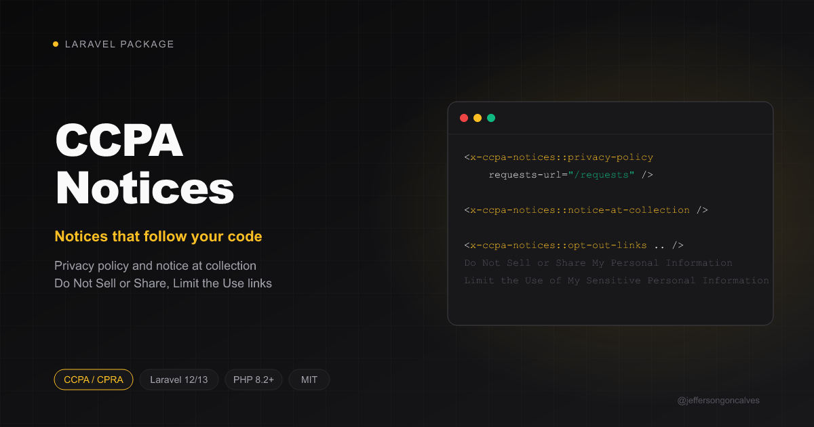

# Laravel CCPA Notices



[](https://packagist.org/packages/jeffersongoncalves/laravel-ccpa-notices)
[](https://github.com/jeffersongoncalves/laravel-ccpa-notices/actions/workflows/tests.yml)
[](https://packagist.org/packages/jeffersongoncalves/laravel-ccpa-notices)

The notices the California Consumer Privacy Act, as amended by the CPRA, asks for, built from the personal information you declared with [laravel-ccpa](https://github.com/jeffersongoncalves/laravel-ccpa). It is part of the laravel-ccpa suite.

- **Privacy policy** (Cal. Civ. Code §1798.130(a)(5); CCPA Regulations §7011): the categories you collected in the past 12 months, the sensitive ones, the business purposes, sources, recipients, retention, the categories you sold or shared, the consumer rights, how to submit a request, and the date it was last updated.
- **Notice at collection** (§1798.100(b)): a short notice for sign-up forms and checkouts.
- **Opt-out links:** "Do Not Sell or Share My Personal Information" when you sell or share, and "Limit the Use of My Sensitive Personal Information" when you collect sensitive information (§1798.135(a)). Each link only shows when you need it.

The categories, the sensitive flag and the sold or shared flags come from your models' `#[PersonalData]`. When a model changes, the notices change with it. You describe the purposes, sources, recipients and retention as processing activities.

> This package gives you tooling. It does not make you compliant on its own. Your notices need legal review.

## Installation

```bash
composer require jeffersongoncalves/laravel-ccpa-notices
php artisan vendor:publish --tag="ccpa-notices-migrations"
php artisan migrate
```

```dotenv
CCPA_BUSINESS_NAME="Acme Inc."
CCPA_BUSINESS_CONTACT=privacy@acme.example
CCPA_TOLL_FREE_NUMBER="1-800-555-0100"
```

## Processing activities

```php
use JeffersonGoncalves\CcpaNotices\Models\ProcessingActivity;

ProcessingActivity::create([
    'name' => 'Checkout',
    'purpose' => 'Process orders and payments',
    'consumers' => ['customers'],
    'models' => [Customer::class],                       // its #[PersonalData] columns join the activity
    'data_categories' => ['order notes'],                // anything not declared on a model
    'sources' => ['directly from you', 'payment processors'],
    'recipients' => [['name' => 'Stripe', 'role' => 'service_provider'], ['name' => 'AdNetwork', 'role' => 'third_party']],
    'retention' => '5 years after the last order',
]);
```

`role` is `service_provider`, `contractor` or `third_party` (§1798.140(ag), (j) and (ai)).

## Rendering

```blade
{{-- the privacy policy page --}}
<x-ccpa-notices::privacy-policy
    requests-url="{{ route('privacy.requests') }}"
    opt-out-url="{{ route('privacy.opt-out') }}"
    limit-url="{{ route('privacy.limit') }}"
    class="prose" />

{{-- next to a sign-up form --}}
<x-ccpa-notices::notice-at-collection policy-url="{{ route('privacy') }}" opt-out-url="{{ route('privacy.opt-out') }}" />

{{-- in your footer --}}
<x-ccpa-notices::opt-out-links opt-out-url="{{ route('privacy.opt-out') }}" limit-url="{{ route('privacy.limit') }}" />
```

Point the opt-out links at pages that use [laravel-ccpa-opt-out](https://github.com/jeffersongoncalves/laravel-ccpa-opt-out). The texts ship in English and Spanish and follow the app locale. Publish them (`--tag="ccpa-notices-translations"`) or the views (`--tag="ccpa-notices-views"`) to change the wording. The markup is plain semantic HTML.

## Export

```bash
php artisan ccpa:notices          # activities, plus what you sell, share and collect as sensitive
php artisan ccpa:notices --json
```

```php
use JeffersonGoncalves\CcpaNotices\Facades\CcpaNotices;

CcpaNotices::export();             // everything the privacy policy discloses
CcpaNotices::sellsOrShares();      // do you need the "Do Not Sell or Share" link?
CcpaNotices::collectsSensitive();  // do you need the "Limit the Use" link?
```

## Testing

```bash
composer test
```

## Changelog

See [CHANGELOG](CHANGELOG.md).

## License

The MIT License (MIT). See [License File](LICENSE.md).
